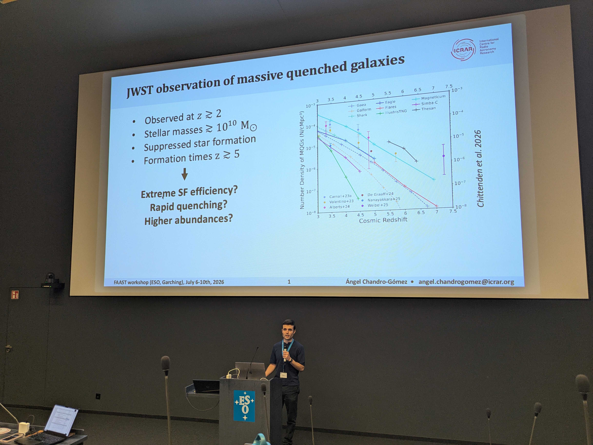
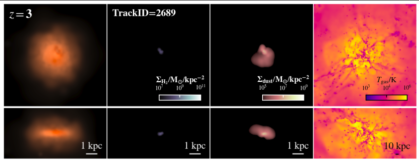

  

    <h1 style="margin-bottom: 5px; border-bottom: none;">Ángel Chandro-Gómez</h1>
    

      <strong>PhD Researcher in Astrophysics</strong> 
      <em>International Centre for Radio Astronomy Research (ICRAR) | The University of Western Australia (UWA)</em>
    

    

      <a href="./AngelChandroGomez_CVacademic_github.pdf">Curriculum Vitae (PDF)</a> &nbsp;|&nbsp; 
      <a href="https://orcid.org/0009-0004-1163-0160" target="_blank">ORCID</a> &nbsp;|&nbsp; 
      <a href="mailto:angel.chandrogomez@research.uwa.edu.au">Email</a> &nbsp;|&nbsp; 
      <a href="https://github.com/angel-chandro" target="_blank">GitHub</a>
    

  

  

    
  

---

 

### Research Overview

I am a final-year PhD researcher at ICRAR/UWA investigating the emergence and evolution of massive quenched galaxies at high redshift (z≥2) using theoretical galaxy formation models. My work connects numerical predictions of this early galaxy population from hydrodynamical suites like <strong>COLIBRE</strong> and semi-analytic models like <strong>SHARK</strong> with observational insights from the <strong>James Webb Space Telescope (JWST)</strong> and other major observing facilities, focusing on population demographics, quenching mechanisms such as AGN feedback and the role of environment. I have expertise in running cosmological simulations, numerical tools that find and track dark matter halos within them, and semi-analytic models.

---

 

### Selected Publications

<strong>Unveiling the population of massive quenched galaxies at z≥2 in the COLIBRE simulations — II. The role of AGN feedback and environment on their emergence</strong> 
<em>A. Chandro-Gómez et al.</em> (2026b), <em>MNRAS</em>, 552, stag1632 
[<a href="https://ui.adsabs.harvard.edu/abs/2025MNRAS.539..776C/abstract" target="_blank">ADS Link</a>]

  

<strong>Unveiling the population of massive quenched galaxies at z≥2 in the COLIBRE simulations — I. Galaxy demographics</strong> 
<em>A. Chandro-Gómez et al.</em> (2026a), <em>MNRAS</em>, 552, stag1481 
[<a href="https://ui.adsabs.harvard.edu/abs/2026MNRAS.552g1481C/abstract" target="_blank">ADS Link</a>]

  

<strong>On the accuracy of halo merger trees and the consequences on semi-analytic models of galaxy formation and evolution</strong> 
<em>A. Chandro-Gómez et al.</em> (2025), <em>MNRAS</em>, 539, 776 
[<a href="https://ui.adsabs.harvard.edu/abs/2026MNRAS.552g1632C/abstract" target="_blank">ADS Link</a>]

  

<em>For a full publication list including co-authored papers, please see my <a href="https://ui.adsabs.harvard.edu/search/q=author%3A%22Chandro-Gomez%2C%20Angel%22" target="_blank">NASA ADS Bibliography</a>.</em>

  
  
<em>Presenting theoretical astrophysics insights at international conferences across Europe and Australia.</em>

---

 

### Technical Expertise

- <strong>Running simulation codes:</strong> DHalo, D-Trees, HBT-HERONS, Shark, Galform, SWIFT, GADGET-4

 

- <strong>Analysis of simulation data:</strong> FLAMINGO, COLIBRE, Shark, Galform

 

- <strong>Programming languages & tools:</strong> Python, C, C++, Fortran, Slurm HPC, Git, TensorFlow, visualisation tools (Matplotlib, Swiftsimio, Swiftgalaxy)

 

  
  
<em>Analysing early-Universe massive quenched galaxies using cosmological simulations.</em>

