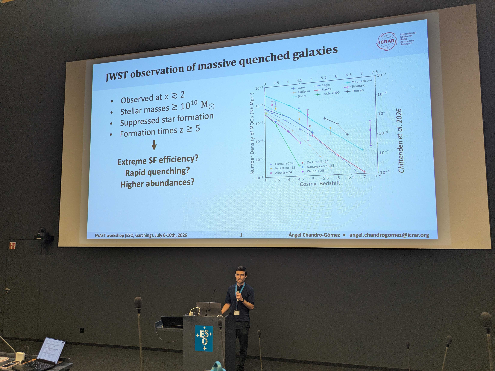
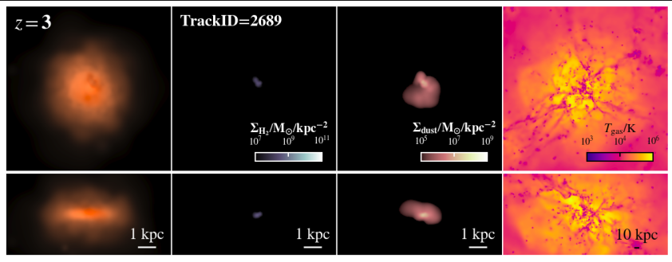

  

    <h1 style="margin-bottom: 5px; border-bottom: none;">Ángel Chandro-Gómez</h1>
    

      <strong>PhD Researcher in Astrophysics</strong> 
      <em>International Centre for Radio Astronomy Research (ICRAR) | The University of Western Australia (UWA)</em>
    

    

      <a href="./AngelChandroGomez_CVacademic_github.pdf">Curriculum Vitae (PDF)</a> &nbsp;|&nbsp; 
      <a href="https://ui.adsabs.harvard.edu/search/q=author%3A%22Chandro-Gomez%2C%20Angel%22">NASA ADS Profile</a> &nbsp;|&nbsp; 
      <a href="https://orcid.org/0009-0004-1163-0160" target="_blank">ORCID</a> &nbsp;|&nbsp; 
      <a href="mailto:angel.chandrogomez@research.uwa.edu.au">Email</a> &nbsp;|&nbsp; 
      <a href="https://github.com/angel-chandro" target="_blank">GitHub</a>
    

  

  

    
  

---

### Research Overview

I am a final-year PhD researcher at ICRAR/UWA investigating the emergence and evolution of massive quenched galaxies at high redshift ($$z ≥ 2$$) using cosmological hydrodynamical simulations. My work connects numerical predictions from hydrodynamical suites like **COLIBRE** and semi-analytic models like **SHARK** with observational insights from the **James Webb Space Telescope (JWST)** and other major observing facilities, focusing on AGN feedback mechanisms and environmental effects. I also have expertise in running simulations and tools that find and connect dark matter halo merger trees within them.

---

### Selected Publications

**Unveiling the population of massive quenched galaxies at $$z \ge 2$$ in the COLIBRE simulations — II. The role of AGN feedback and environment on their emergence** 
*A. Chandro-Gómez et al.* (2026b), *MNRAS*, 552, stag1632
[ADS Link](https://ui.adsabs.harvard.edu/search/q=author%3A%22Chandro-Gomez%2C%20Angel%22)

**Unveiling the population of massive quenched galaxies at $$z \ge 2$$ in the COLIBRE simulations — I. Galaxy demographics**
*A. Chandro-Gómez et al.* (2026a), *MNRAS*, 552, stag1481 
[ADS Link](https://ui.adsabs.harvard.edu/search/q=author%3A%22Chandro-Gomez%2C%20Angel%22)

**On the accuracy of halo merger trees and the consequences on semi-analytic models of galaxy formation and evolution**
*A. Chandro-Gómez et al.* (2025), *MNRAS*, 539, 776
[ADS Link](https://ui.adsabs.harvard.edu/search/q=author%3A%22Chandro-Gomez%2C%20Angel%22)

*For a full publication list including co-authored papers, please see my [NASA ADS Bibliography](https://ui.adsabs.harvard.edu/search/q=author%3A%22Chandro-Gomez%2C%20Angel%22).*

  
  
<em>Presenting theoretical astrophysics insights at international conferences across Europe and Australia.</em>[cite: 4, 5]

---

### Technical Expertise

- **Running simulation codes:** DHalo, D-Trees, HBT-HERONS, Shark, Galform, SWIFT, GADGET-4
- **Analysis of simulation data:** FLAMINGO, COLIBRE, Shark, Galform
- **Programming languages & tools:** Python, C, C++, Fortran, Slurm HPC, Git, TensorFlow, Visualization tools

  
  
<em>Analysing early-Universe massive quenched galaxies using cosmological simulations.</em>[cite: 2]

